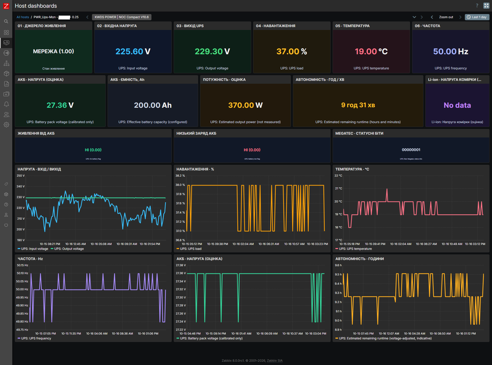
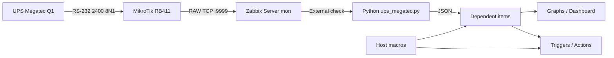

<div align="center">

# KWDS POWER
### UPS Monitoring Platform

**Універсальний моніторинг ДБЖ Megatec через MikroTik RB411 та Zabbix**


-d61f26?style=flat-square)


**[Архітектура](#архітектура)** · **[Початок роботи](#швидкий-старт)** · **[Обладнання](#підтримуване-середовище)** · **[Безпека](#безпека)** · **[Ліцензія](#ліцензія-та-використання)**

</div>

---

## Дашборд KWDS POWER



> **Зображення:** `bg.png` має лежати поруч із `README.md` у корені репозиторію. Воно є демонстрацією інтерфейсу, а не підтвердженням поточного стану ДБЖ. Якщо файлу немає, додай власний скріншот під назвою `bg.png`.

## Про платформу

**KWDS UPS Monitoring** збирає показники UPS з Megatec `Q1`, отримуючи дані RS-232 через RAW TCP сервер старої, але корисної MikroTik RB411. Один Python-колектор використовується для кількох UPS, а специфіка кожного вузла визначається **макросами хоста Zabbix**. Не потрібні окремі Python-сервіси для кожного пристрою.

| Компонент | Зафіксована версія / стан |
|---|---|
| Шаблон і дашборд | **V10.7** (2026-10-16), під Zabbix 8.0.0rc1 |
| Python-колектор | **V10.5**, Python 3, лише стандартна бібліотека |
| Тестовий UPS-шлюз | `RB411`, RouterOS `6.49.23`, `mipsbe` |
| Лінія UPS | RS-232, `2400` baud, `8N1`, Megatec `Q1` |
| RAW TCP | `172.16.0.25:9999` (Почаїв, історична конфігурація) |
| Імпорт V10.7 у production | **Не підтверджено** |
| Калібрований SOC Li-ion | **Недоступний**; пороги 30/15% не активувати без перевіреного SOC |

### Можливості

- **Безпечний read-only collector:** надсилає тільки `Q1`, не керує UPS.
- **External check + dependent items:** один JSON → напруга, навантаження, частота, температура, прапорці й стан живлення.
- **Українська індикація:** `МЕРЕЖА`, `БАТАРЕЯ`, `НИЗЬКИЙ ЗАРЯД`, `НЕВІДОМО` без технічного `(1.00)`.
- **Індивідуальні макроси:** IP/порт, калібрування напруги, ємність, номінальна потужність, температурні й аварійні пороги.
- **Розрахункові показники:** напруга блока, оцінка напруги комірки, оцінка потужності та автономності. Це *не прямі вимірювання BMS*.
- **Масштабування:** спільний template для 10+ UPS; перевіряй навантаження сервера та RAW Serial concurrency.
- **Спостережуваність:** дашборд, графіки, тригери, історія даних, тести й операційні інструкції.

## Архітектура



> `External check` виконується сервером Zabbix; Python не відкриває мережевий порт для приймання даних. Не запускай паралельно старий trapper-collector та новий external check, доки не перевірена конкуренція за RAW Serial.

## Підтримуване середовище

| Рівень | Перевірено / обмеження |
|---|---|
| **MikroTik RB411** | Один miniPCI, MIPSBE, 32 MiB RAM, CPU 300 MHz; Serial-to-TCP |
| **RouterOS 6.49.23** | Підтверджено CLI на вузлі `mt_PWR_*` 2026-10-15 |
| **Zabbix 8.0.0rc1** | Цільовий формат YAML; повний імпорт V10.7 ще не підтверджено |
| **Python 3** | Стандартна бібліотека (`socket`, `json`, `re`, `time`) |
| **BLE BMS через RB411** | Не підтримується підтвердженою конфігурацією; окремий ESP32/Linux BLE gateway — проєктна альтернатива |

Раніше на RB411 зафіксовано **100% CPU та 5.4 MiB вільної RAM**. Це історичний знімок, а не твердження про його теперішній стан. Деталі: [RB411](docs/RB411.md).

## Структура репозиторію

```text
.
├── bg.png                         # Скріншот дашборду (додай власний файл)
├── collector/ups_megatec.py        # Read-only збирач Megatec Q1
├── zabbix/
│   ├── KWDS_UPS_V10_7_Final_Zabbix8.yaml
│   └── history/                   # Попередні ревізії YAML
├── docs/
│   ├── ARCHITECTURE.md
│   ├── RB411.md
│   ├── DEPLOYMENT.md
│   ├── OPERATIONS.md
│   ├── TRIGGERS.md
│   ├── CHANGELOG.md
│   └── DECISIONS.md
├── examples/pochaiv.host-macros.example
├── tests/                          # Offline unittest
├── LICENSE
└── README.md
```

## Швидкий старт

### 1. Перевір залежності та тести

```bash
python3 --version
python3 -m py_compile collector/ups_megatec.py
python3 -m unittest discover -s tests -v
```

### 2. Тестове опитування на `mon`

```bash
# mon, root: після перевірки наявного скрипта
sudo -u zabbix python3 /usr/lib/zabbix/externalscripts/ups_megatec.py \
    172.16.0.25 9999 3
```

Очікується один валідний JSON. На помилці колектор завершується з ненульовим кодом і повідомленням у `stderr`. Не замінюй робочий Python без резервної копії.

### 3. Імпортуй шаблон

`Data collection → Templates → Import` → `zabbix/KWDS_UPS_V10_7_Final_Zabbix8.yaml`.

- Увімкни **Update existing** для потрібних елементів.
- **Delete missing = OFF**, доки не звірено зміни.
- Для кожного UPS створи окремий host із макросами, не копіюй чужі параметри калібрування.
- Перевір `Latest data`, `Execute now`, статуси, тригери та Actions для сповіщень.

Повний сценарій із **backup, перевіркою і rollback**: [DEPLOYMENT.md](docs/DEPLOYMENT.md).

## Конфігурація й калібрування

| Макрос хоста | Призначення |
|---|---|
| `{$UPS.IP}`, `{$UPS.PORT}` | MikroTik RAW TCP endpoint |
| `{$UPS.TIMEOUT}`, `{$UPS.INTERVAL}`, `{$UPS.NODATA}` | Таймаут / період / відсутність даних |
| `{$UPS.BATTERY.MULTIPLIER}` | Перерахунок Megatec RAW у напругу блока, тільки після звірки |
| `{$UPS.CELL.MULTIPLIER}` | Оцінка напруги комірки, **не вимірювання BMS** |
| `{$UPS.CAPACITY}`, `{$UPS.USABLE}`, `{$UPS.EFF}` | Оціночний енергетичний запас |
| `{$UPS.POWER.RATED.W}` | Номінальна активна потужність у **W**, не VA |
| `{$UPS.BATTERY.VOLT.MIN/MAX}` | Межі моделі автономності |
| `{$UPS.SOC.WARN}`, `{$UPS.SOC.CRIT}` | Пороги 30% / 15% для *каліброваного* SOC |
| `{$UPS.SOC.ALERTS.ENABLED}` | `0`: відсоткові аварії вимкнені до перевірки SOC |

Приклад хоста: [pochaiv.host-macros.example](examples/pochaiv.host-macros.example). Опис повного набору макросів є у YAML-шаблоні.

### Важливі обмеження оцінок

- `ups.BatteryRaw` — сире число Q1, не напруга комірки і не SOC.
- `ups.BatteryVoltage` та `ups.CellVoltageEstimated` розраховуються з множників конкретного хоста.
- `ups.OutputPowerEstimated` оцінюється з номіналу та відсотка навантаження.
- `ups.RuntimeEstimated` — нелінійна модель за напругою, а не калібрований таймер гарантованого вимкнення.
- Для змішаних Li-ion 6S/7S фактичну автономність потрібно уточнювати за природними циклами розряду.

## Моніторинг і аварії

Збережені тригери: **відсутність даних, перехід на АКБ, BatteryLow, вхідна/вихідна напруга, температура, частота, навантаження, попередження та критичний рівень напруги АКБ**. Додаткові пороги SOC 30/15% **не вмикати без реального каліброваного SOC**.

> **Trigger ≠ доставка сповіщення.** Email/Telegram потребують відповідних налаштувань *Media types, Actions* та реальної перевірки доставки.

Докладно: [TRIGGERS.md](docs/TRIGGERS.md) і [OPERATIONS.md](docs/OPERATIONS.md).

## Безпека

- Зберігай репозиторій **приватним**, поки власник не визначить умови доступу й ліцензування.
- Не коміть паролі, API-токени, приватні SNMP community, експортовані секретні макроси, RouterOS backup з автентифікаційними даними.
- На `mon` запускати скрипт від `zabbix`; права й шлях перевіряти до змін.
- Використовується **read-only Megatec Q1**; керувальні команди UPS не надсилаються.
- Проводь діагностику без масових restart/flush і змін RS-232 налаштувань робочого вузла.

## Версії та історія

| Версія | Дата | Зміни |
|---|---|---|
| **V10.7** | 2026-10-16 | Український статус живлення через текстовий item; прибрано `(1.00)` |
| V10.6 | 2026-10-16 | Описи макросів, версія дашборду, компактні шрифти |
| V10.5 | 2026-10-16 | Колектор Python, батарейні розрахунки, V10.5 шаблон |
| V4–V10.4 | Історичні ревізії | Поступова побудова External check, dependent items, автономності та візуалізації |

Повна хронологія: [CHANGELOG.md](docs/CHANGELOG.md). Архітектурні рішення: [DECISIONS.md](docs/DECISIONS.md).

## Ліцензія та використання

**Статус: пропрієтарний внутрішній проєкт із невизначеними правами на зовнішнє використання.** Наявний файл [LICENSE](LICENSE) прямо вказує, що публічну ліцензію *ще не обрано*. Це **не MIT, GPL чи Apache-2.0** і не дозвіл на копіювання або розповсюдження. Умови використання й переліцензування визначає власник KWDS. Файл `LICENSE` навмисно залишено без змін.

Технології **Zabbix, MikroTik RouterOS і Python** належать їхнім відповідним власникам і розповсюджуються за власними умовами ліцензування; цей репозиторій не передає прав на стороннє ПЗ.

---

<div align="center">

**KWDS POWER · Infrastructure Monitoring**

<sub>Документація репозиторію · 2026-10-16 · Dashboard V10.7 / Collector V10.5</sub>

</div>
